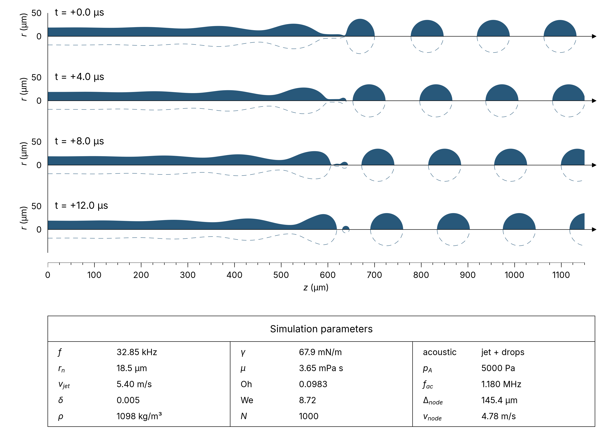

## Microjet Breakup Model 2

A numerical lubrication approximation model for the breakup of an axisymmetric liquid microjet. Implemented in C++ using the blisteringly fast [Heyoka ODE library](https://bluescarni.github.io/heyoka/). 

<figure>
  
  <figcaption align="center">Fig. 1. Simulation of liquid microjet breakup using parameters from van Hoeve et al. with acoustic forcing applied to the jet.</figcaption>
</figure>

## References

1. van Hoeve, W., Gekle, S., Snoeijer, J. H., Versluis, M., Brenner, M. P., & Lohse, D. (2010). Breakup of diminutive Rayleigh jets. *Physics of Fluids*, 22(12). AIP Publishing. https://doi.org/10.1063/1.3524533

2. Biscani, F., & Izzo, D. (2021). Revisiting high-order Taylor methods for astrodynamics and celestial mechanics. *Monthly Notices of the Royal Astronomical Society*, 504(2), 2614–2628. https://doi.org/10.1093/mnras/stab1032

© Grady Conwell, 2026

